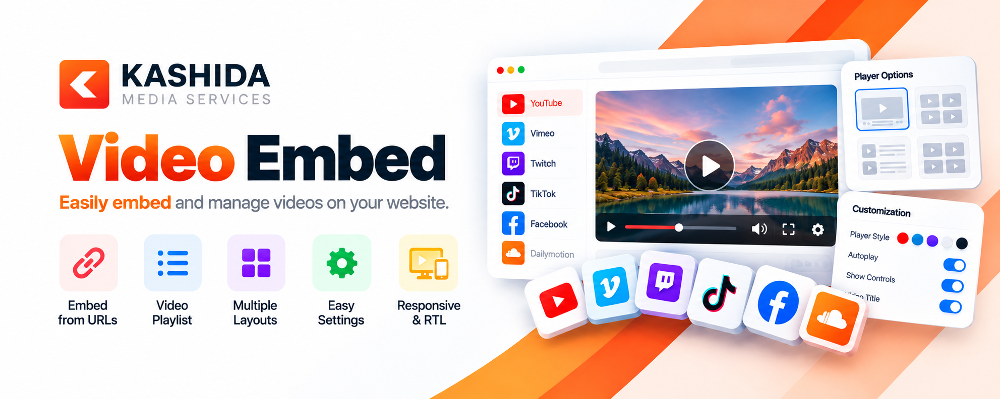
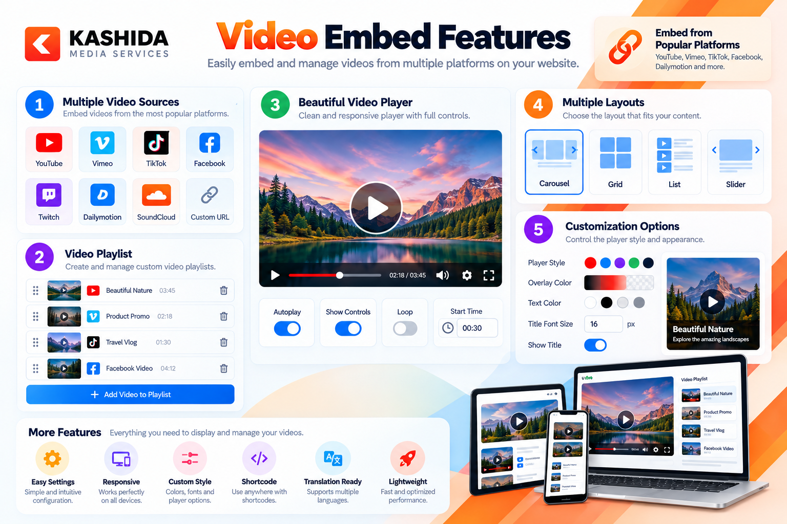
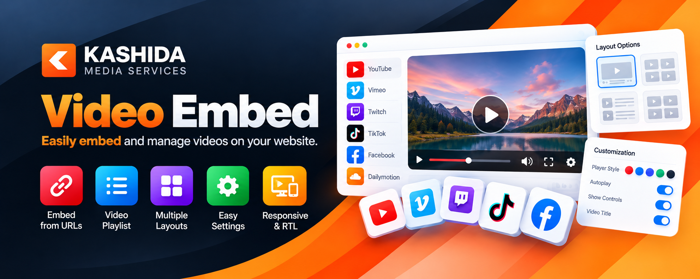
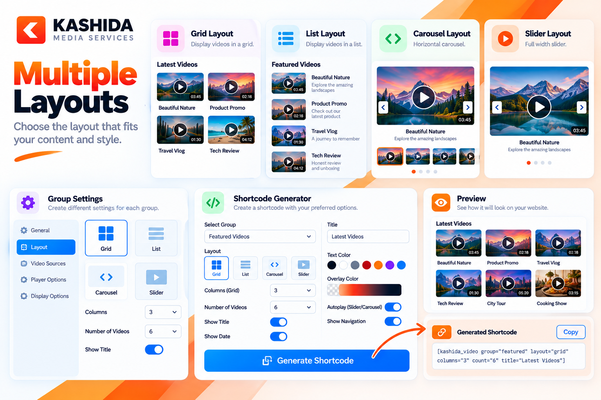
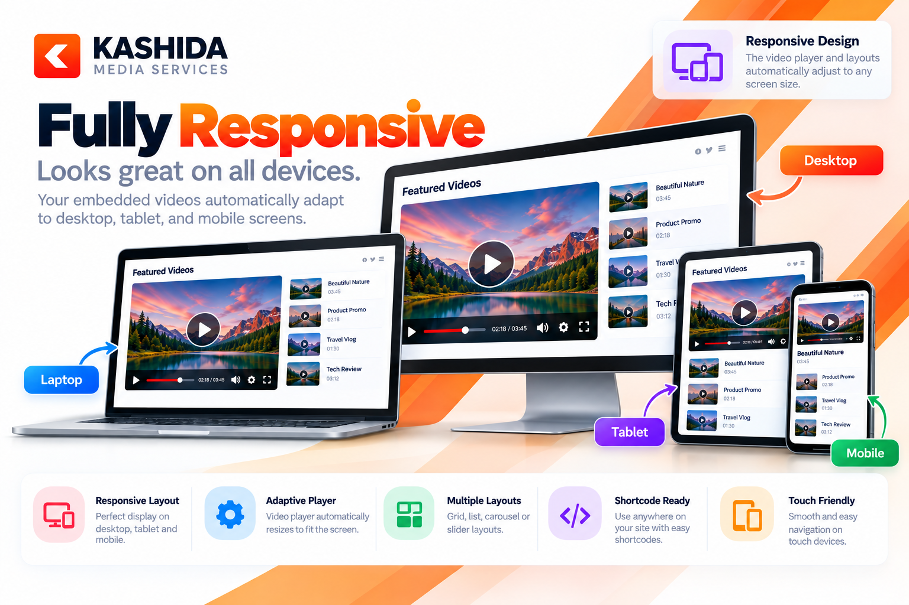
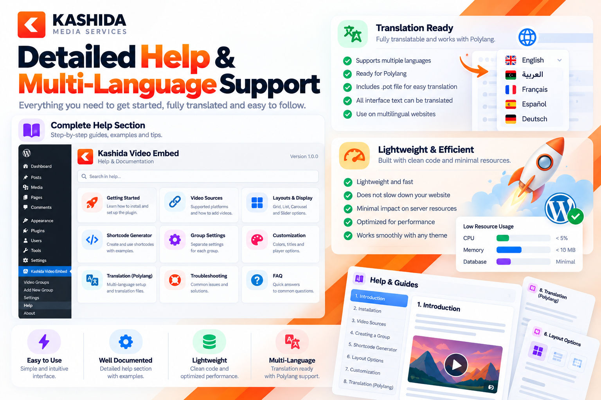

<p align="center">
  
</p>

<h1 align="center">
  
  Kashida Video Embed
</h1>

<p align="center">A lightweight WordPress plugin for embedding videos and displaying them in flexible, responsive layouts.</p>
<p align="center"><strong>Version 1.4.22</strong> · <strong>GPL-2.0-or-later</strong></p>

<p align="center">
  <a href="https://github.com/mrwan-bg/kashida-video-embed/releases/tag/v1.4.22">Download v1.4.22</a> ·
  <a href="https://github.com/mrwan-bg/kashida-video-embed/issues">Report an issue</a>
</p>

---

## Overview

**Kashida Video Embed** makes it easier to add supported video URLs to WordPress and present video content without manually writing embed code. Use the plugin to configure video displays, customize their appearance, and place them in your pages or posts with shortcodes.

It can be useful for tutorials, educational content, news, reviews, portfolios, interviews, and other video-focused websites.

## Key features

- **Four display layouts:** Grid, List, Carousel, and Slider.
- **Independent group settings:** configure display settings for each video group independently.
- **Shortcode generator:** generate a shortcode and choose the available layout and display options.
- **Visual customization:** adjust supported colors, titles, and presentation settings.
- **Responsive video display:** layouts are designed to work across different screen sizes.
- **Translation-ready:** translation support helps multilingual WordPress sites.
- **Built-in Help section:** usage guidance is available from the plugin administration area.
- **Lightweight approach:** designed to add video display functionality without turning the plugin into a general-purpose page builder.

Video playback and embedding behavior may vary by provider, privacy settings, browser, and the provider's current policies.

## Layout gallery

<table>
  <tr>
    <td width="50%" align="center">
      <strong>Grid</strong><br>
      <a href="screenshots/video-embed-features-showcase.png"></a>
      <br><sub>Display multiple videos in a structured grid.</sub>
    </td>
    <td width="50%" align="center">
      <strong>List</strong><br>
      <a href="screenshots/kashida-video-embed-showcase.png"></a>
      <br><sub>Present video items in a clear browsing format.</sub>
    </td>
  </tr>
  <tr>
    <td width="50%" align="center">
      <strong>Carousel</strong><br>
      <a href="screenshots/kashida-video-layout-showcase.png"></a>
      <br><sub>Browse videos in a horizontally navigable layout.</sub>
    </td>
    <td width="50%" align="center">
      <strong>Slider</strong><br>
      <a href="screenshots/fully-responsive-video-embed-showcase.png"></a>
      <br><sub>Feature video content in a slide-based presentation.</sub>
    </td>
  </tr>
</table>

## More screenshots

<table>
  <tr>
    <td width="50%" align="center">
      <a href="screenshots/kashida-video-embed-plugin-overview.png"></a>
      <br><strong>Plugin overview</strong>
    </td>
    <td width="50%" align="center">
      <a href="screenshots/embed-videos-with-ease.png"></a>
      <br><strong>Easy video embedding</strong>
    </td>
  </tr>
  <tr>
    <td width="50%" align="center">
      <a href="screenshots/kashida-plugin-support-showcase.png"></a>
      <br><strong>Help and support</strong>
    </td>
    <td width="50%" align="center">
      <a href="screenshots/plugin-icon.png"></a>
      <br><strong>Plugin icon</strong>
    </td>
  </tr>
</table>

## How it works

1. **Add video content** using a URL supported by the plugin.
2. **Configure a video group** and select the layout you want to use.
3. **Customize the display** using the options available in the plugin.
4. **Generate the shortcode** and copy it from the plugin interface.
5. **Publish the content** by placing the shortcode in a WordPress page, post, or compatible shortcode area.

For the most reliable results, use the shortcode generated by the installed version of the plugin rather than copying an example and assuming every attribute is supported.

## Requirements and compatibility

- A WordPress installation where you have permission to install and activate plugins.
- A PHP version supported by both WordPress and this plugin release.
- A video URL supported by the plugin and permitted to be embedded by its provider.

The exact minimum WordPress and PHP versions are not stated here because they have not been independently verified against the release's plugin header. Check the plugin metadata and the [v1.4.22 release](https://github.com/mrwan-bg/kashida-video-embed/releases/tag/v1.4.22) before installing on a production site.

### Important notes about video providers

- Videos may need to be public or have embedding enabled.
- A provider may restrict playback by region, account, privacy settings, or domain.
- The plugin cannot override restrictions imposed by the original provider.
- Playback controls and behavior can differ between platforms and browsers.

## Installation

### Install using the release ZIP

1. Download **[kashida-video-embed-1.4.22.zip](https://github.com/mrwan-bg/kashida-video-embed/releases/download/v1.4.22/kashida-video-embed-1.4.22.zip)**.
2. In your WordPress dashboard, open **Plugins → Add New Plugin → Upload Plugin**.
3. Select the downloaded ZIP and click **Install Now**.
4. Click **Activate Plugin**.
5. Open the plugin's administration screen and follow the built-in Help instructions.

### Install from the WordPress plugin directory

If the plugin is available in the directory for your site, open **Plugins → Add New Plugin**, search for **Kashida Video Embed**, then install and activate it.

## Shortcode usage

The plugin includes a shortcode generator. Use the shortcode created by the plugin interface for your actual configuration.

Illustrative example for a saved video:

```text
[kashida_video_embed id="123"]
```

Illustrative example using a supported video URL:

```text
[kashida_video_embed url="https://youtu.be/VIDEO_ID" ratio="16:9"]
```

Replace the sample ID or URL with your own. These examples are illustrative; use the attributes and shortcode format supported by the installed release.

## Troubleshooting

- **The video is missing:** check the URL, confirm that the source is supported, and verify the provider's embedding permissions.
- **Playback is blocked:** review the video's privacy settings, regional restrictions, and provider account requirements.
- **The shortcode is shown as text:** place it in a WordPress content area that processes shortcodes.
- **The layout differs from the preview:** check the selected display settings, theme styles, and screen size.
- **A previously working embed stops working:** test the source URL directly; providers can change their embedding rules independently of the plugin.

When reporting a problem, include the plugin, WordPress, and PHP versions, the selected layout, the video provider, and reproducible steps. Do not include passwords, private tokens, or other credentials.

## Support and contributions

- **Issues and bug reports:** [GitHub Issues](https://github.com/mrwan-bg/kashida-video-embed/issues)
- **Source repository:** [mrwan-bg/kashida-video-embed](https://github.com/mrwan-bg/kashida-video-embed)
- **Releases and downloads:** [GitHub Releases](https://github.com/mrwan-bg/kashida-video-embed/releases)

## Author

**Kashida Media Services**  
Website: [https://kashida.ly/](https://kashida.ly/)

## License

Kashida Video Embed is distributed under the **GPL-2.0-or-later** license. See [LICENSE](LICENSE).
