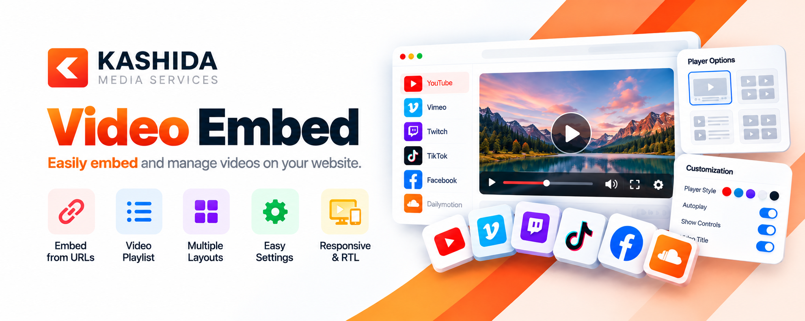
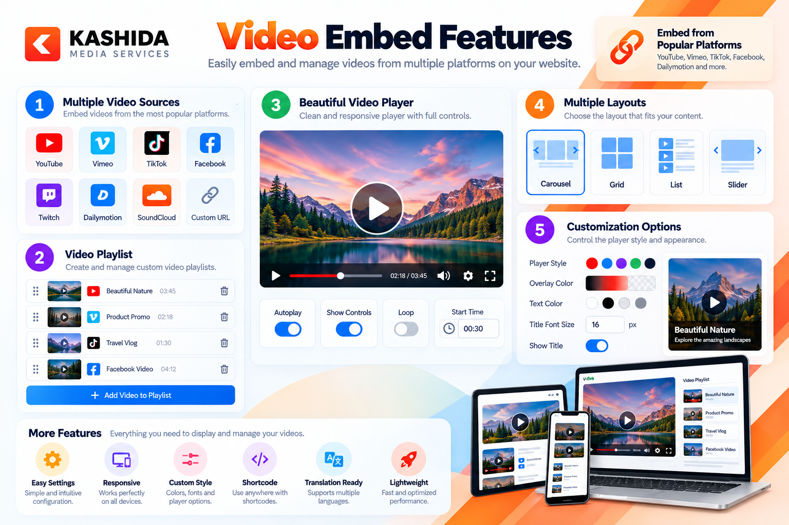
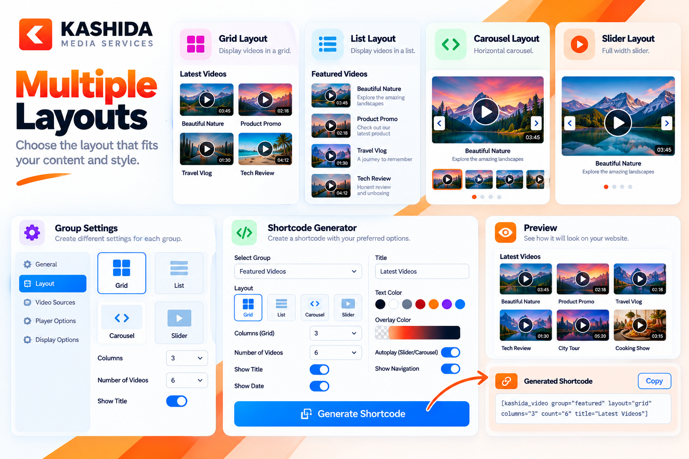
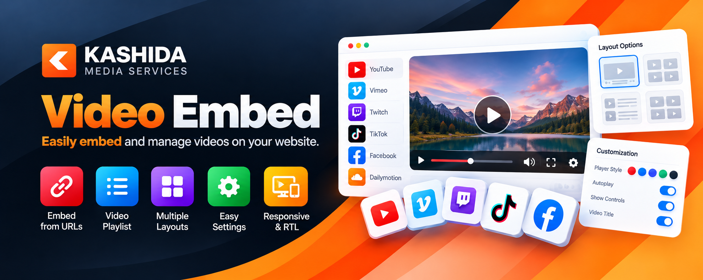
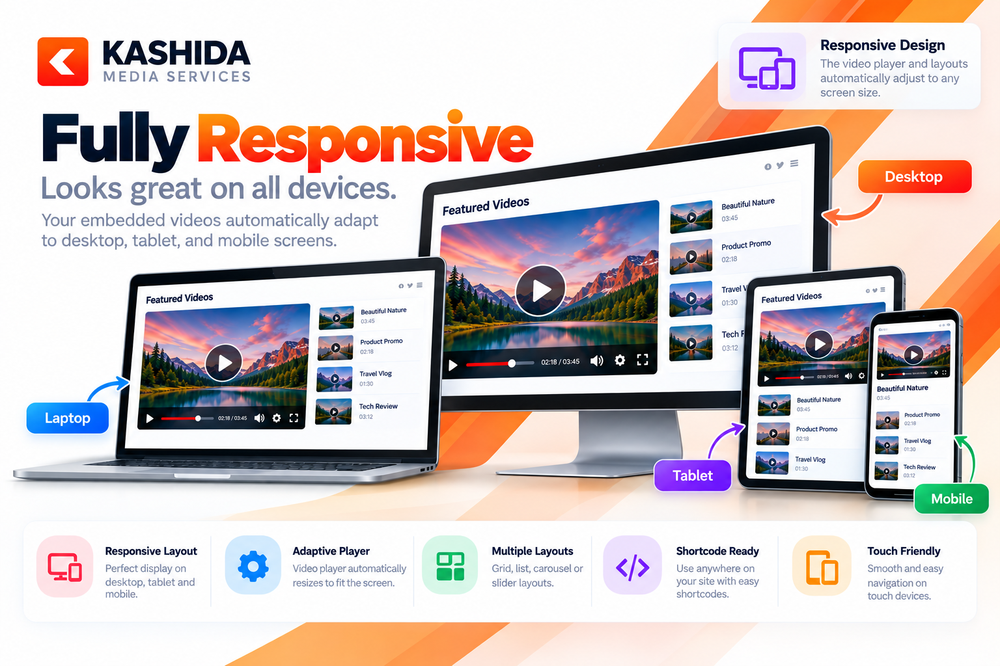
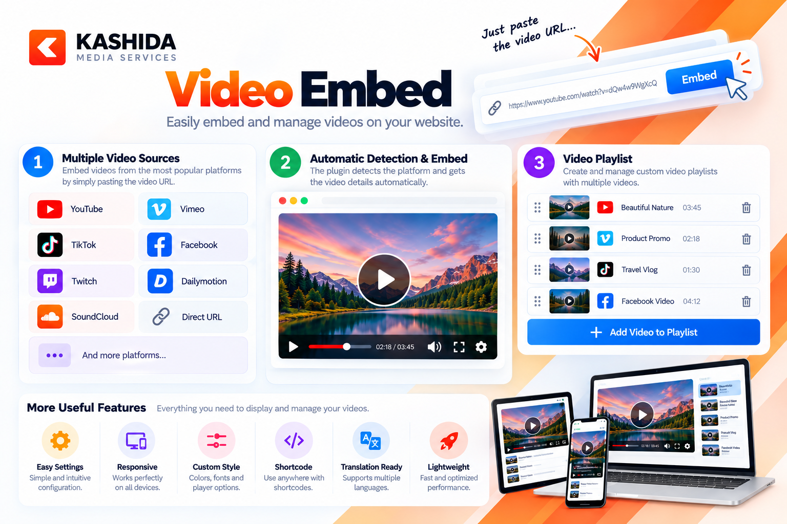
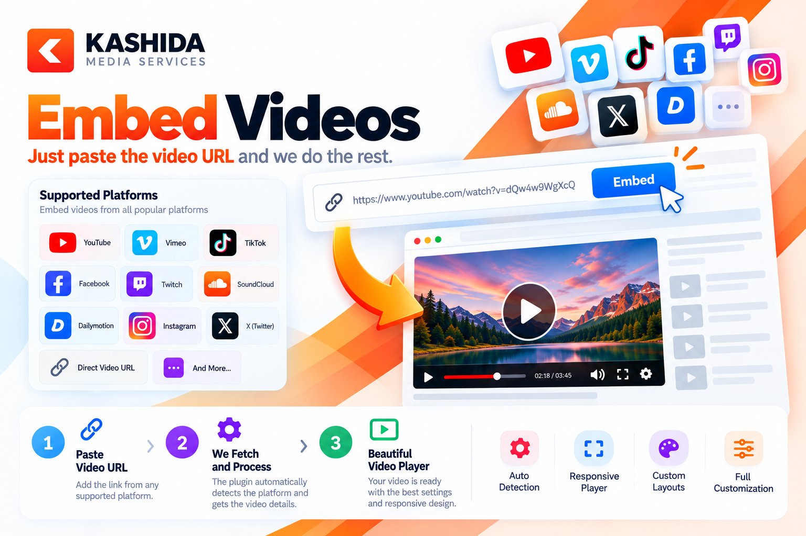
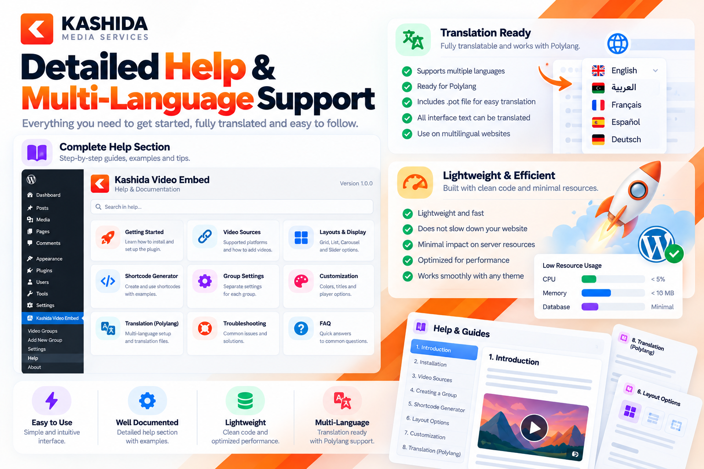

<p align="center">
  
</p>

<h1 align="center">
  
  Kashida Video Embed
</h1>

<p align="center">A WordPress plugin for embedding videos and displaying them in reusable, responsive layouts.</p>
<p align="center">
  <a href="https://wordpress.org/plugins/kashida-video-embed/"></a>
  <a href="https://kashida.ly/wp-plugins/kashida-video-embed/"></a>
</p>
<p align="center"><strong>Version 1.4.23</strong> · <strong>WordPress 6.0+</strong> · <strong>PHP 7.4+</strong> · <strong>GPL-2.0-or-later</strong></p>

<p align="center">
  <a href="https://github.com/mrwan-bg/kashida-video-embed/releases/download/v1.4.23/kashida-video-embed-1.4.23.zip">Download v1.4.23</a> ·
  <a href="https://github.com/mrwan-bg/kashida-video-embed/issues">Report an issue</a>
</p>

---

## Overview

**Kashida Video Embed** helps WordPress site editors add supported video URLs without manually writing embed code. Manage videos in a searchable library, create reusable collections, customize the display, and insert content with shortcodes or the Gutenberg block.

Suitable for educational websites, tutorials, news, reviews, portfolios, interviews, and other video-focused content.

## Key features

- **Five collection layouts:** Grid, List, Carousel, Slider, and Featured + Playlist.
- **Video library:** save and manage videos from supported public URLs or supported provider embed code.
- **Reusable collections:** group videos and display them in multiple places.
- **Shortcode generator:** choose available layout and display options and copy the generated shortcode.
- **Layout customization:** adjust supported colors, titles, spacing, columns, and other settings depending on the selected layout.
- **Responsive presentation:** adapt the display to different screen sizes using available settings.
- **Gutenberg block:** embed supported video content in the block editor.
- **Arabic translation:** Arabic translation files are included.
- **Built-in Help section:** access usage guidance from the plugin administration area.
- **Privacy-conscious behavior:** the plugin does not send analytics or video data to Kashida; third-party video players may connect to their own providers when loaded.

## Layout gallery

<table>
  <tr>
    <td width="50%" align="center">
      <a href="screenshots/video-embed-features-showcase.png"></a>
      <br><strong>Features overview</strong>
    </td>
    <td width="50%" align="center">
      <a href="screenshots/kashida-video-layout-showcase.png"></a>
      <br><strong>Layout options</strong>
    </td>
  </tr>
  <tr>
    <td width="50%" align="center">
      <a href="screenshots/kashida-video-embed-showcase.png"></a>
      <br><strong>Plugin showcase</strong>
    </td>
    <td width="50%" align="center">
      <a href="screenshots/fully-responsive-video-embed-showcase.png"></a>
      <br><strong>Responsive display</strong>
    </td>
  </tr>
  <tr>
    <td width="50%" align="center">
      <a href="screenshots/kashida-video-embed-plugin-overview.png"></a>
      <br><strong>Plugin overview</strong>
    </td>
    <td width="50%" align="center">
      <a href="screenshots/embed-videos-with-ease.png"></a>
      <br><strong>Video embedding</strong>
    </td>
  </tr>
  <tr>
    <td width="50%" align="center">
      <a href="screenshots/kashida-plugin-support-showcase.png"></a>
      <br><strong>Help and support</strong>
    </td>
    <td width="50%" align="center">
      <a href="screenshots/plugin-icon.png"></a>
      <br><strong>Plugin icon</strong>
    </td>
  </tr>
</table>

## Supported video sources

Supported sources include YouTube, Vimeo, Facebook, X/Twitter, Dailymotion, TikTok, Twitch, Instagram, and WordPress.tv when embedding is permitted. Supported direct video files include MP4, WebM, and OGV.

Provider restrictions still apply. Some services require canonical URLs, a provider-specific player ID, HTTPS, a configured parent domain, authentication, or embedding permission. The plugin cannot override restrictions imposed by the original provider.

## How it works

1. **Add a video:** open the plugin's administration area and paste a supported URL or provider embed code.
2. **Save and manage videos:** use the video library to organize and find saved entries.
3. **Create a collection:** select the videos you want to display together.
4. **Choose a layout:** select Grid, List, Carousel, Slider, or Featured + Playlist and adjust the available settings.
5. **Generate the shortcode:** use the collection generator and copy the shortcode it produces.
6. **Publish:** insert the shortcode in a WordPress page, post, or compatible shortcode area. Use the Gutenberg block for supported individual video embeds.

## Requirements and compatibility

| Requirement | Supported version |
| --- | --- |
| WordPress minimum | 6.0 |
| PHP minimum | 7.4 |
| Tested up to | WordPress 7.1 |
| Stable plugin version | 1.4.23 |
| License | GPL-2.0-or-later |

Use a currently supported PHP release where your hosting environment and WordPress installation allow it. Back up your site and test updates on a staging site before deploying them to production.

## Installation

1. Download [kashida-video-embed-1.4.23.zip](https://github.com/mrwan-bg/kashida-video-embed/releases/download/v1.4.23/kashida-video-embed-1.4.23.zip).
2. In WordPress, go to **Plugins → Add New Plugin → Upload Plugin**.
3. Select the downloaded ZIP and click **Install Now**.
4. Click **Activate Plugin**.
5. Open **Kashida Video Embed** in the WordPress admin menu and follow the built-in Help instructions.

## Shortcode examples

Use the shortcode generated by the plugin interface for your saved video or collection. The following examples illustrate the available individual-video shortcode formats:

```text
[kashida_video_embed id="123"]
```

```text
[kashida_video_embed url="https://youtu.be/VIDEO_ID" ratio="16:9"]
```

Replace the example ID or URL with your own content. Use only attributes supported by the installed version; for saved collections, copy the generated shortcode instead of guessing its identifier.

## Privacy

The plugin does not send analytics or video data to Kashida. Embedded third-party players may connect to their own providers when a visitor loads a page containing a video. Each provider's privacy policy and embedding behavior apply.

## Troubleshooting

- **Video does not display:** check that the URL is correct, supported, and publicly accessible; confirm that the provider permits embedding.
- **Twitch playback fails:** Twitch may require HTTPS and a matching parent domain. Local development domains and iframe policies can prevent playback.
- **Dailymotion playback fails:** check the Player ID or use the official embed code where required.
- **Shortcode appears as plain text:** insert it in a WordPress content area or block that processes shortcodes.
- **Layout differs from the preview:** review the selected layout settings, theme styles, and viewport size.

When reporting an issue, include the plugin version, WordPress version, PHP version, provider, selected layout, and reproducible steps. Do not include passwords, private tokens, or other credentials.

## External services

The plugin connects to third-party services only when the corresponding video provider is used or when a visitor loads an embedded player. It does not send analytics or video viewing data to Kashida.

- **X (formerly Twitter):** For X post embeds, the WordPress server may request the public oEmbed endpoint at `publish.twitter.com/oembed` and the syndication endpoint at `cdn.syndication.twimg.com/tweet-result` to retrieve embed markup or public media URLs. The request includes the post URL or post ID. The visitor's browser may load `platform.twitter.com/widgets.js` and X-hosted embed content. [X Privacy Policy](https://x.com/en/privacy) · [X Terms](https://x.com/en/tos).
- **YouTube:** When a YouTube video is displayed, the visitor's browser loads the YouTube player and related resources. The provider may receive the page URL, IP address, browser/device information, and cookies or similar identifiers according to the visitor's browser settings. [Google Privacy Policy](https://policies.google.com/privacy) · [YouTube Terms](https://www.youtube.com/t/terms).
- **Vimeo:** When a Vimeo video is displayed, the visitor's browser connects to Vimeo's player and related resources. Vimeo may receive standard connection and device data. [Vimeo Privacy Policy](https://vimeo.com/privacy) · [Vimeo Terms](https://vimeo.com/terms).
- **Facebook and Instagram (Meta):** When these embeds are displayed, the visitor's browser connects to Meta-hosted embed/player resources. Meta may receive standard connection, device, and page interaction data. [Meta Privacy Policy](https://www.facebook.com/privacy/policy/) · [Meta Terms](https://www.facebook.com/terms/).
- **Dailymotion:** When a Dailymotion video is displayed, the visitor's browser loads the Dailymotion player and related resources. [Dailymotion Privacy Policy](https://www.dailymotion.com/legal/privacy) · [Dailymotion Terms](https://www.dailymotion.com/legal/terms).
- **TikTok:** When a TikTok embed is displayed, the visitor's browser loads the TikTok player at `www.tiktok.com/player/v1/` and related resources. [TikTok Privacy Policy](https://www.tiktok.com/legal/page/row/privacy-policy/en) · [TikTok Terms](https://www.tiktok.com/legal/page/row/terms-of-service/en).
- **Twitch:** When a Twitch video or clip is displayed, the visitor's browser loads the Twitch player or clip embed. Twitch requires the parent domain in the embed URL. [Twitch Privacy Notice](https://www.twitch.tv/p/en/legal/privacy-notice/) · [Twitch Terms](https://www.twitch.tv/p/en/legal/terms-of-service/).
- **WordPress.tv:** When a WordPress.tv video is embedded, the visitor's browser connects to WordPress.tv and its video delivery provider. [WordPress.org Privacy Policy](https://wordpress.org/about/privacy/).

These connections are initiated only for the relevant provider/embed. Third-party providers may process data under their own policies and may set cookies or similar technologies. The plugin does not control their data practices.

## Development and repository

- **Collection generator source:** [assets/src/collection-generator.js](assets/src/collection-generator.js) is the readable source corresponding to the runtime file [assets/collection-generator.js](assets/collection-generator.js). Keep both files synchronized when making changes; no build step is required for this plain JavaScript asset.

- [Source code](https://github.com/mrwan-bg/kashida-video-embed)
- [Releases and downloads](https://github.com/mrwan-bg/kashida-video-embed/releases)
- [Report a bug or request a feature](https://github.com/mrwan-bg/kashida-video-embed/issues)
- [Screenshots directory](https://github.com/mrwan-bg/kashida-video-embed/tree/main/screenshots)

## Author

**Kashida Media Services** · [kashida.ly](https://kashida.ly/)

## License

Kashida Video Embed is distributed under the **GPL-2.0-or-later** license. See [LICENSE](LICENSE).
